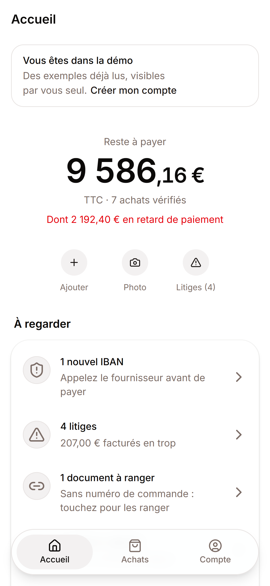
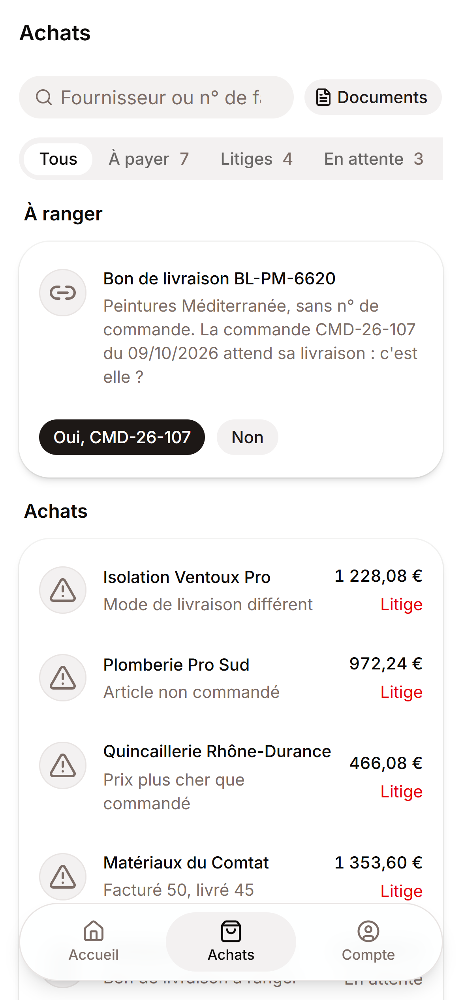
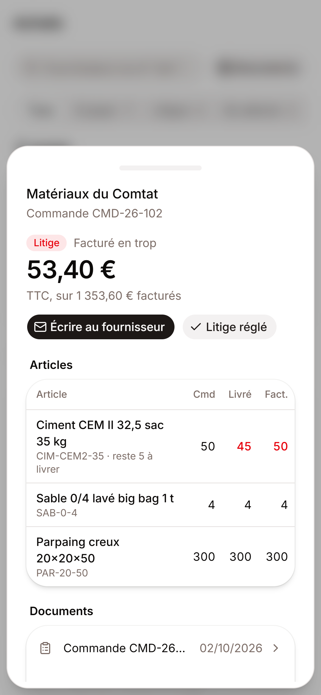
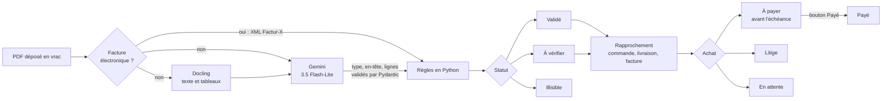
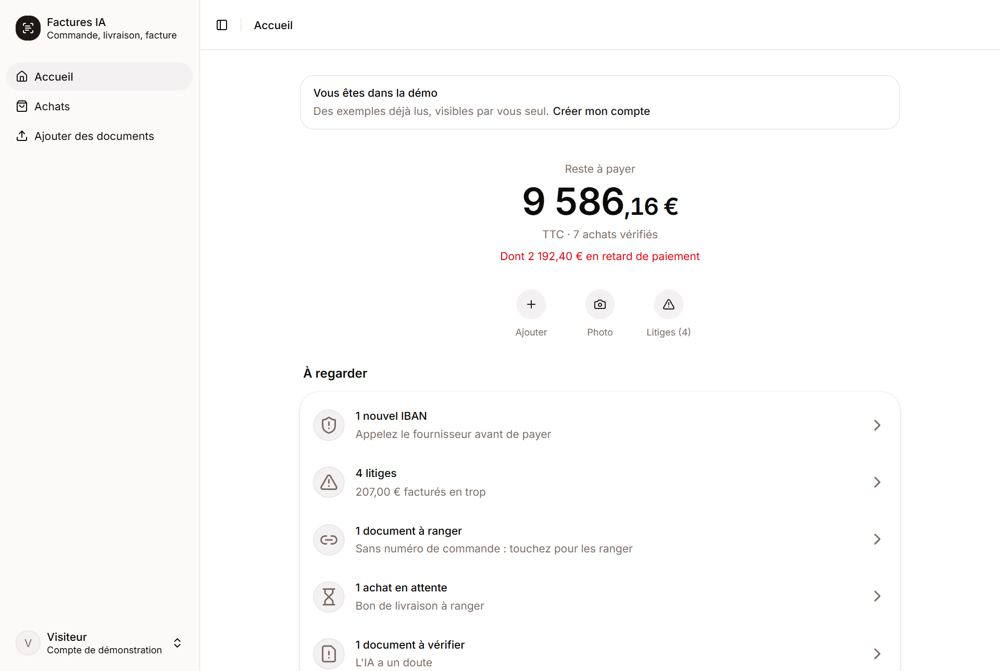
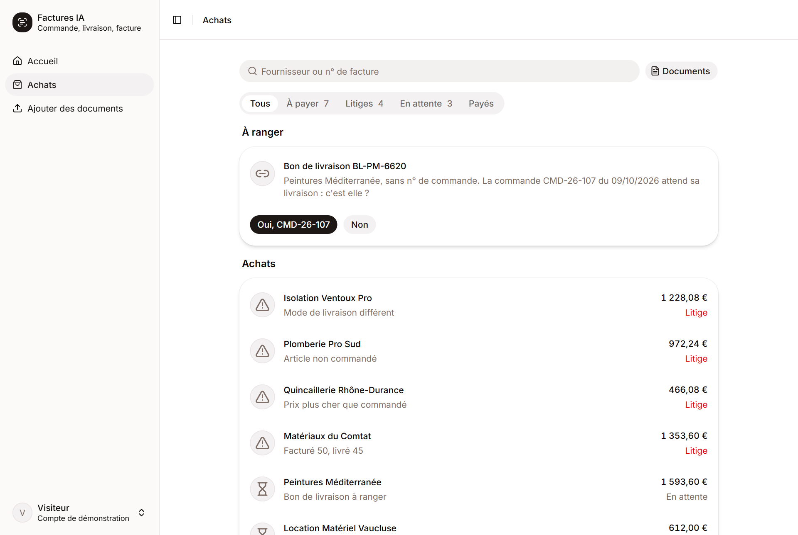
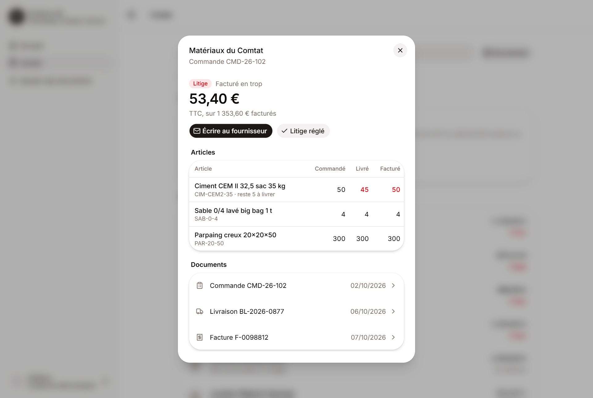

<div align="center">
  

  [](https://github.com/Jeremy84100/factures-ia/actions/workflows/test-backend.yml)
  [](https://factures-ia.vercel.app)
  [](https://www.python.org)
  [](https://fastapi.tiangolo.com)
  [](https://react.dev)
  [](LICENSE)

  [Démo](#démo) • [Fonctionnement](#fonctionnement) • [Vérifications](#vérifications) • [Rapprochement](#rapprochement) • [Résultats](#résultats-mesurés) • [Lancer en local](#lancer-en-local) • [Crédits](#crédits-et-licence)
</div>

Factures IA lit des factures, des bons de commande et des bons de livraison en PDF avec Gemini, contrôle ce qu'il a lu avec des règles écrites en Python, puis range le résultat dans PostgreSQL. Un document qui ne passe pas les contrôles est mis de côté avec la raison, et se corrige à la main.

Il rapproche ensuite les trois documents d'un même achat, ligne par ligne, et répond à la question du patron : est-ce que je dois payer cette facture ?

Le cas d'usage visé : une PME du bâtiment ou un grossiste qui reçoit des centaines de factures fournisseurs par mois et ne veut plus les saisir ni les pointer à la main.

<table>
  <tr>
    <td></td>
    <td></td>
    <td></td>
  </tr>
</table>

## Démo

https://factures-ia.vercel.app

Le bouton **Essayer la démo** ouvre, sans inscription, un compte rempli avec les 33 documents de [`backend/app/demo/purchases`](backend/app/demo/purchases), déjà lus : 13 achats avec chacun un piège. Chaque visiteur a son propre compte de démo, effacé au bout de 24 heures. Les documents y sont chargés tels que Gemini les lit (33 sur 33, mesuré plus bas), puis passent les vrais contrôles et le vrai rapprochement : le verdict affiché sort du même code qu'un vrai dépôt.

Pour voir l'IA lire, créez un compte et déposez ces PDF en vrac, ou prenez un bon de livraison en photo avec votre téléphone : les photos JPEG, PNG et WebP sont réduites dans le navigateur, puis converties en PDF par le serveur. Les factures de [`backend/tests/fixtures/invoices`](backend/tests/fixtures/invoices) passent toutes ; pour voir les contrôles en action, prenez un avoir ou une facture américaine dans les jeux de données cités plus bas.

La première lecture prend jusqu'à une minute, le temps que le serveur gratuit démarre et charge Docling. Les suivantes prennent entre 5 et 20 secondes.

## Fonctionnement



1. Le fichier est contrôlé (signature `%PDF` ou photo, 10 Mo au plus ; une photo devient un PDF d'une page) puis stocké en base, sans type. Le traitement part en arrière-plan et l'interface se met à jour toute seule.
1. Une **facture électronique** (Factur-X, ZUGFeRD) porte ses chiffres dans un fichier XML joint au PDF. Depuis le 1er septembre 2026, toutes les entreprises françaises doivent pouvoir en recevoir. Ce XML est lu tel quel, en quelques millisecondes, sans OCR ni IA : fournisseur, numéro, dates, échéance, totaux, IBAN, e-mail du fournisseur, numéro de commande et lignes sont exacts. Si le XML n'a pas de lignes (profils MINIMUM et BASIC WL), seule la lecture des lignes est confiée à l'IA. Testé sur les 20 exemples officiels Factur-X et ZUGFeRD cités plus bas.
2. [Docling](https://github.com/docling-project/docling) extrait le texte et les tableaux des 5 premières pages.
3. Gemini reçoit le PDF complet et le texte de Docling. Il voit les logos et la mise en page, le texte l'aide à lire les chiffres. En un seul appel, il renvoie le type (facture, avoir, bon de commande, bon de livraison), le fournisseur, le numéro, la date, le numéro de commande de l'acheteur, les totaux, la mention d'exonération de TVA, la date d'échéance et les conditions de paiement recopiées telles quelles (« 45 jours fin de mois »), l'IBAN et l'e-mail du fournisseur, et chaque ligne d'article (référence, désignation, quantité, prix). La date d'échéance n'est jamais calculée par l'IA : si elle n'est pas imprimée, le code la déduit des conditions ; s'il n'y a rien, l'appli compte les 30 jours du délai légal (code de commerce, art. L441-10) et le dit.
4. Les règles de [`checks.py`](backend/app/services/checks.py) décident du statut, avec des règles propres à chaque type. Elles ne font pas appel à l'IA et sont testées seules.
5. [`reconciliation.py`](backend/app/services/reconciliation.py) regroupe les documents par numéro de commande et les compare ligne par ligne.
6. Un document corrigé à la main (type, champs, numéro de commande, lignes) repasse les contrôles, et son achat est recalculé. On peut aussi relancer la lecture par l'IA.

L'accueil donne en gros le **reste à payer, TTC** (ce qui sort vraiment du compte), dont la part en retard de paiement, puis ce qu'il faut regarder, en phrases : litiges et montant facturé en trop, livraisons pas encore reçues, documents à ranger ou à vérifier. Viennent ensuite les prochains paiements, triés par échéance.



## Interface

- [shadcn/ui](https://ui.shadcn.com) avec le preset `radix-luma`, couleur de base taupe, sur Tailwind CSS 4. Les composants sont ceux du registre, sans retouche : `Sidebar` pour la navigation sur ordinateur, `Item` pour les listes, `Tabs` pour les filtres, `Card`, `Badge`, `Alert`, `Table`, `Empty`, `Field` et `InputGroup` pour les formulaires, `AlertDialog` pour les suppressions, `Dialog` sur ordinateur et `Drawer` sur téléphone pour les détails.
- Sur téléphone, une présentation d'appli bancaire : le montant à payer en grand, des boutons ronds (Ajouter, Photo qui ouvre l'appareil photo, Litiges), des listes regroupées dans un seul bloc avec le montant TTC et l'échéance à droite, trois onglets en bas de l'écran (Accueil, Achats, Compte), et les détails qui montent du bas. La liste brute des documents s'ouvre depuis les achats, là où elle sert. Les détails tiennent en peu de place : le montant et les boutons en trois lignes, les articles en tableau (une ligne par article, commandé, livré et facturé côte à côte, le chiffre en cause en rouge). Achats et documents ont une recherche ; chercher un fournisseur donne aussi ce qu'on lui doit.
- Aucun écran qui clignote : chaque page charge ses données avant de s'afficher (préchargées dès que le doigt ou la souris touche le lien), les onglets filtrent dans le navigateur sans recharger, et le thème clair ou sombre est appliqué avant le premier affichage.

## Vérifications

| Règle | Exemple de message |
|---|---|
| HT + TVA = TTC, à 2 centimes près | HT + TVA = 220.00 mais TTC = 440.00 |
| Fournisseur, date et TTC présents | Champ introuvable : fournisseur |
| Même fournisseur, même numéro, même montant | Doublon possible de « facture-mars.pdf » |
| Même fournisseur, même numéro, autre montant | Même numéro que « facture-mars.pdf » mais un autre montant |
| TVA à 0 sans mention d'exonération (obligatoire en France, art. 242 nonies A de l'annexe II du CGI) | TVA à 0 sans mention d'exonération |
| Aucun montant de TVA | Montant de TVA introuvable |
| Montant négatif sur une facture qui n'est pas un avoir | Montant négatif sur une facture (avoir ?) |
| Date américaine ambiguë lue au format européen | Date « 06/02/2015 » à vérifier : jour et mois peuvent être inversés |
| Date dans le futur | Date dans le futur |
| Quantité × prix = montant de chaque ligne | CAB-3G25 : 50 × 1.19 = 59.50 mais montant = 95.20 |
| Somme des lignes = total HT | Somme des lignes = 59.50 mais total HT = 70.00 (remise globale ?) |
| Bon de commande ou de livraison sans ligne | Aucune ligne d'article trouvée |
| Bon de livraison sans numéro de commande | Numéro de commande introuvable : à ranger dans son achat |
| Bon de commande dont la livraison promise précède la commande | Date de livraison promise avant la date du document |
| Document qui n'est ni une facture, ni une commande, ni une livraison | Ni facture, ni bon de commande, ni bon de livraison |

Les doublons sont cherchés parmi les documents du même type : une facture et un bon de livraison peuvent porter le même numéro.

Un avoir est toujours compté en négatif, même quand il est écrit avec des montants positifs comme le prévoit la norme EN 16931.

<table>
  <tr>
    <td></td>
    <td></td>
  </tr>
</table>

## Rapprochement

Les documents d'un même achat sont retrouvés par le numéro de commande, imprimé sur le bon de livraison et la facture (« Votre commande »). Une commande peut avoir plusieurs livraisons et plusieurs factures : les quantités s'additionnent, les avoirs se déduisent.

Chaque article est retrouvé d'un document à l'autre par sa référence, sinon par sa désignation avec [RapidFuzz](https://github.com/rapidfuzz/RapidFuzz) : « PACK WC SUSPENDU + BATI SUPPORT » et « Pack WC suspendu bâti-support » sont le même article. Deux désignations qui ne portent pas les mêmes cotes ne sont jamais confondues : une gaine de 20 mm n'est pas une gaine de 25 mm.

La règle de fond est celle d'Odoo et d'ERPNext : **on paie ce qui a été commandé et livré, au prix commandé.**

| Règle | Exemple de message | Effet |
|---|---|---|
| Facturé plus que livré | Ciment CEM II : facturé 50, livré 45 | Litige |
| Livré plus que commandé | Câble R2V : livré 60, commandé 50 | Litige |
| Prix facturé plus cher que la commande (à 1 centime près) | Cheville Ø8 : prix facturé 7,45 € au lieu de 6,75 € commandé | Litige |
| Article facturé ou livré sans avoir été commandé | Vanne 20x27 : facturé mais pas commandé | Litige |
| Fournisseurs ou devises différents dans un même achat | Fournisseurs différents : Rexel / Sonepar | Litige |
| Livraison datée avant la commande | Livraison « bl.pdf » datée avant la commande | Litige |
| Mode de livraison différent de la commande | Mode de livraison du BL-IVP-2208 : « Livraison standard J+3 » au lieu de « Livraison express 24 h » commandé | Litige |
| Total facturé supérieur à ce qui est dû | Total facturé 131,50 € HT au lieu de 101,50 € | Litige |
| Prix facturé moins cher que la commande | prix facturé 1,10 €, plus bas que les 1,19 € commandés | Noté |
| Livraison partielle | reste 5 à livrer | Noté |
| Livré après la date promise | BL-CL-4471 livré le 19/10/2026, 7 jours après la date promise (12/10/2026) | Noté |
| Date promise dépassée, rien de livré | Livraison promise le 12/10/2026, toujours pas reçue (36 jours de retard) | Noté |

Le mode de livraison est recopié tel qu'il est écrit, puis rangé par Gemini en trois catégories : retrait par le client, livraison standard, livraison express. Ce sont les catégories qui sont comparées, pas les mots : « Retrait au comptoir » et « Enlèvement par le client » sont la même chose. Un retard n'empêche pas de payer, il est seulement noté, par exemple pour réclamer des pénalités.

Les frais de port, de livraison, l'écotaxe ou l'emballage ne figurent jamais sur un bon de livraison. Comme les services dans Odoo, ils sont payés sur la quantité commandée, pas sur la quantité livrée. Des frais facturés sans avoir été commandés restent un litige.

Un achat a l'un de ces quatre états :

| État | Quand |
|---|---|
| **À payer** | La livraison et la facture sont là et concordent, avec ou sans bon de commande (beaucoup de petites entreprises commandent par téléphone). Ou bien une facture arrive seule, sans commande ni livraison à comparer : abonnement, énergie, loyer, prestation. |
| **Litige** | Au moins une règle du tableau n'est pas respectée. |
| **En attente** | Il manque la livraison ou la facture, ou l'IA a un doute sur un des documents : on ne passe pas au vert tant que ce n'est pas vérifié. |
| **Payé** | Le bouton **Payé** a été touché. Une facture qui arrive ensuite reste à payer ; un écart découvert après paiement redevient un litige, avec la mention « déjà payé : demandez un avoir ». |

Un bon de livraison sans numéro de commande, ou une facture sans numéro d'un fournisseur à qui l'on a passé commande, attend dans **À ranger**. L'appli propose l'achat du même fournisseur qui l'attend (« c'est la commande CMD-26-107 ? ») : un geste suffit, sans rien taper. Tant qu'il n'est pas rangé, la commande n'est pas annoncée « pas reçue » : l'appli dit qu'un bon de livraison de ce fournisseur attend d'être rangé.

Une livraison promise et pas reçue propose **Relancer** : un mail au fournisseur qui rappelle la commande et la date promise.

Le rapprochement n'est pas stocké : il est recalculé à chaque affichage par une fonction pure. Une correction ou une suppression ne laisse donc jamais de résultat périmé.

### Régler un litige

Dans le détail d'un litige, deux boutons :

- **Écrire au fournisseur** prépare le mail, adressé à l'e-mail lu sur ses documents : la facture et la commande concernées, la liste des écarts, le montant facturé en trop, et la demande d'un avoir ou d'une facture corrigée. Le texte est écrit à partir de la comparaison, sans l'IA : chaque chiffre est un chiffre vérifié. On peut le modifier, le copier ou l'ouvrir dans sa messagerie.
- **Réglé** range l'achat dans les achats à payer, une fois l'accord trouvé. Les écarts restent affichés pour mémoire, et **Rouvrir** annule. L'avoir, une fois déposé, est déduit du montant à payer.

Le règlement ne vaut que pour les écarts qu'il y avait à ce moment-là. Si un nouveau document en fait apparaître d'autres, le litige se rouvre tout seul.

### Payer, et envoyer au comptable

- Un achat à payer montre l'**IBAN** de la facture, avec un bouton **Copier l'IBAN** pour le virement. Une facture en retard de paiement rappelle que le fournisseur peut réclamer 40 € d'indemnité (code de commerce, art. L441-10).
- **Changement de RIB** : c'est l'arnaque qui vise le plus les PME, un faux fournisseur qui « change de banque ». L'IBAN est vérifié (clé ISO 13616) puis comparé à celui de la facture précédente du même fournisseur. S'il a changé, l'achat est bloqué en attente, avec une alerte rouge en haut et sur l'accueil : appeler le fournisseur à un numéro déjà connu, pas celui de la facture. Le bouton **J'ai appelé, l'IBAN est bon** débloque la facture.
- **Payé** range l'achat dans les payés, avec la date ; **Pas payé** annule. Le reste à payer de l'accueil baisse d'autant. Pour un avoir seul, le bouton devient **Déduit**.
- Dans **Compte, Mes données**, **Pour le comptable** télécharge un zip : un tableau des factures et avoirs (date, fournisseur, numéro, HT, TVA, TTC, échéance, date de paiement) qui s'ouvre tel quel dans Excel en français, et les PDF nommés par date, fournisseur et numéro. Tout, ou un mois choisi.

<table>
  <tr>
    <td></td>
    <td></td>
  </tr>
</table>

## Résultats mesurés

[`scripts/evaluate.py`](backend/scripts/evaluate.py) compare les réponses à la vérité sur 12 factures françaises générées par [`scripts/generate_invoices.py`](backend/scripts/generate_invoices.py) : 100 % de champs justes. Ces factures sont propres, le chiffre ne dit donc pas grand-chose seul.

Le projet a aussi été passé sur 42 factures publiques :

- 7 exemples officiels Factur-X de la FNFE (facture France, DOM, UE, avoir) et 13 cas allemands difficiles (taxi, loyer, assurance, devise étrangère, avoirs), tirés du [corpus ZUGFeRD](https://github.com/ZUGFeRD/corpus) ;
- 12 factures d'entreprises réelles (AWS, Free, Coolblue, Hetzner, Flipkart…) tirées des tests d'[invoice2data](https://github.com/invoice-x/invoice2data) ;
- 10 scans sans texte, avec leur bonne réponse, tirés du [jeu de données de sparrow](https://huggingface.co/datasets/katanaml-org/invoices-donut-data-v1).

| | Première version (texte seul) | Version actuelle |
|---|---|---|
| Fournisseur faux ou introuvable | 4 | 0 |
| Date américaine inversée | 3, sans alerte | 3, toutes signalées |
| Avoir signalé à tort ou compté en positif | 3 | 0 |
| Facture sans TVA ni mention, non signalée | 3 | 0 ou 1 (*) |
| Montant faux non signalé | 0 | 0 |
| Montants des 10 scans | 10 justes | 10 justes |

(*) La facture AWS porte la phrase « This is not a VAT invoice ». Selon les passages, Gemini la recopie comme mention d'exonération ou non : la facture est alors validée ou signalée.

Pour le rapprochement, [`scripts/generate_purchases.py`](backend/scripts/generate_purchases.py) fabrique 13 achats de grossistes, d'entreprises du bâtiment, d'un opérateur télécom et d'un loueur de matériel, soit 33 PDF, chacun avec un piège connu : quantité facturée non livrée, prix augmenté, article ajouté, livraison en deux fois, désignations réécrites, bon de livraison sans numéro de commande, facture sans commande, livraison en retard, express commandé mais livré en standard, facture d'abonnement seule, IBAN changé d'un mois sur l'autre. Les IBAN sont fictifs (code banque 99999, qu'aucune banque n'utilise). Les factures portent des conditions de paiement variées : « 45 jours », « 30 jours fin de mois », « à réception », une date imprimée, ou rien. [`scripts/evaluate_purchases.py`](backend/scripts/evaluate_purchases.py) les passe dans Docling et Gemini :

| | Résultat |
|---|---|
| Type de document reconnu | 33 / 33 |
| Numéro et numéro de commande | 33 / 33 |
| Lignes lues (nombre, quantités, prix) | 33 / 33 |
| Mode et date de livraison (commandes et bons de livraison) | 20 / 20 |
| Échéance, IBAN et e-mail du fournisseur (factures) | 13 / 13 chacun |
| Verdict de l'achat | 13 / 13 |

Ces PDF sont propres et générés : ce score montre que la chaîne marche de bout en bout, pas qu'elle résiste à un bon de livraison scanné et froissé. C'est le prochain jeu de test à constituer.

Une mesure a aussi servi à corriger la consigne : ajouter des champs l'a rendue instable sur « Livraison dépôt », rangé une fois sur deux en retrait. Préciser que le mot livraison veut dire que le fournisseur apporte a ramené le résultat à 4 sur 4 à chaque passage.

Deux idées ont été essayées puis retirées, parce que les mesures ne les justifiaient pas :

- préciser le format des dates dans la consigne : Gemini inverse toujours les dates américaines, seule la règle en Python les attrape ;
- demander à Gemini une note de confiance par champ : il se donne 1,0 sur une date fausse.

## Hébergement gratuit : ce qu'il a fallu régler

Le site tourne sur une fonction Python Vercel gratuite (2 Go de mémoire, 5 minutes par requête) et une base Neon.

| Problème constaté en ligne | Mesure | Correction |
|---|---|---|
| PyTorch tire 3 Go de pilotes NVIDIA | paquet de 4 Go et plus | version CPU de PyTorch sous Linux |
| Plusieurs lectures Docling en parallèle | serveur tué (code 137) | une seule lecture Docling à la fois |
| OCR de Docling sur des PDF chargés d'images | 2,46 Go | OCR coupé, Gemini lit les scans : 1,41 Go |
| PDF de 40 pages | 2,11 Go | 5 pages au plus, une par une : 1,20 Go |
| Facture bloquée « en lecture » après un plantage | pour toujours | passe en erreur au bout de 10 minutes et se relance |

## Architecture

```
backend/app/
  api/routes/documents.py        dépôt en vrac, liste, correction, relecture, PDF, totaux
  api/routes/reconciliations.py  achats, payé, litige réglé, mail au fournisseur
  services/einvoice.py           facture électronique : XML Factur-X lu sans IA
  services/pdf_reader.py         PDF vers texte (Docling)
  services/extraction.py         PDF et texte vers type, champs et lignes (Gemini)
  services/checks.py             règles de contrôle par type, sans base ni IA
  services/reconciliation.py     rapprochement ligne par ligne, sans base ni IA
  services/payment_terms.py      échéance tirée des conditions de paiement
  services/supplier_email.py     mail de litige ou de relance, sans IA
  services/export.py             zip pour le comptable (tableau et PDF)
  services/iban.py               IBAN vérifié, changement de RIB repéré
  services/processing.py         enchaîne lecture, extraction et contrôles
backend/scripts/
  create_admin.py          crée un administrateur, mot de passe saisi au clavier
  evaluate.py              score sur les 12 factures de test
  generate_purchases.py    13 achats de démonstration (33 PDF)
  evaluate_purchases.py    score de lecture et de rapprochement sur ces achats
  vercel-build.sh          build de l'interface, modèles Docling, migrations
frontend/src/
  routes/_layout/index.tsx            accueil : reste à payer, à regarder, échéances
  routes/_layout/reconciliations.tsx  achats par état, documents à ranger
  routes/_layout/documents.tsx        documents, filtres par type et par statut
  components/Documents/               dépôt, correction (type, champs, lignes), actions
  components/Purchases/               détail d'un achat ligne par ligne, actions, mail
  components/UserSettings/            compte, export pour le comptable
```

Docling et Gemini sont derrière deux interfaces (`PdfReader`, `DocumentExtractor`). Les 261 tests les remplacent par de fausses versions et tournent sans clé API ni réseau. Changer de modèle demande une seule classe.

Stack : FastAPI, SQLModel, Pydantic, Alembic, PostgreSQL, Docling, Gemini (`google-genai`), RapidFuzz, React 19, Vite, TanStack Router et Query, Tailwind, shadcn/ui, Pytest, uv, bun. Tests et lint dans GitHub Actions, déploiement continu sur Vercel.

## Lancer en local

Il faut Docker Desktop, [uv](https://docs.astral.sh/uv/) et [bun](https://bun.sh).

```bash
cp .env.example .env
```

Dans `.env`, mettez votre `SECRET_KEY`, le mot de passe Postgres et votre `GEMINI_API_KEY` ([Google AI Studio](https://aistudio.google.com)).

```bash
docker compose up -d db
cd backend && uv sync && uv run alembic upgrade head && uv run python scripts/create_admin.py
cd ../frontend && bun install && bun run build
cd ../backend && uv run fastapi dev
```

L'application est sur http://localhost:8000. Sous Windows, préfixez les commandes `fastapi` par `PYTHONUTF8=1` si la console affiche une erreur d'encodage.

```bash
cd backend && uv run pytest
cd backend && uv run python scripts/evaluate.py
cd backend && uv run python scripts/evaluate_purchases.py
```

## Crédits et licence

- [Full Stack FastAPI Template](https://github.com/fastapi/full-stack-fastapi-template) (MIT, voir [`LICENSE-full-stack-fastapi-template`](LICENSE-full-stack-fastapi-template)) : base du projet, comptes, interface.
- [paperless-ngx](https://github.com/paperless-ngx/paperless-ngx) : traitement en arrière-plan, une erreur claire par étape.
- [sparrow](https://github.com/katanaml/sparrow) : interface commune pour changer de modèle d'extraction.
- [TaxHacker](https://github.com/vas3k/TaxHacker) : consigne par champ dans le schéma, règle « ne rien inventer », limite du nombre de pages lues.
- [Odoo](https://github.com/odoo/odoo) et [ERPNext](https://github.com/frappe/erpnext) : règles du rapprochement (contrôle sur les quantités reçues, tolérance sur les quantités, prix facturé égal au prix commandé). [Dolibarr](https://github.com/Dolibarr/dolibarr) : vocabulaire français commande, réception, facture fournisseur. Idées seulement, aucun code repris.
- [RapidFuzz](https://github.com/rapidfuzz/RapidFuzz) (MIT) : comparaison des désignations d'articles.

Licence GPL-3.0.
