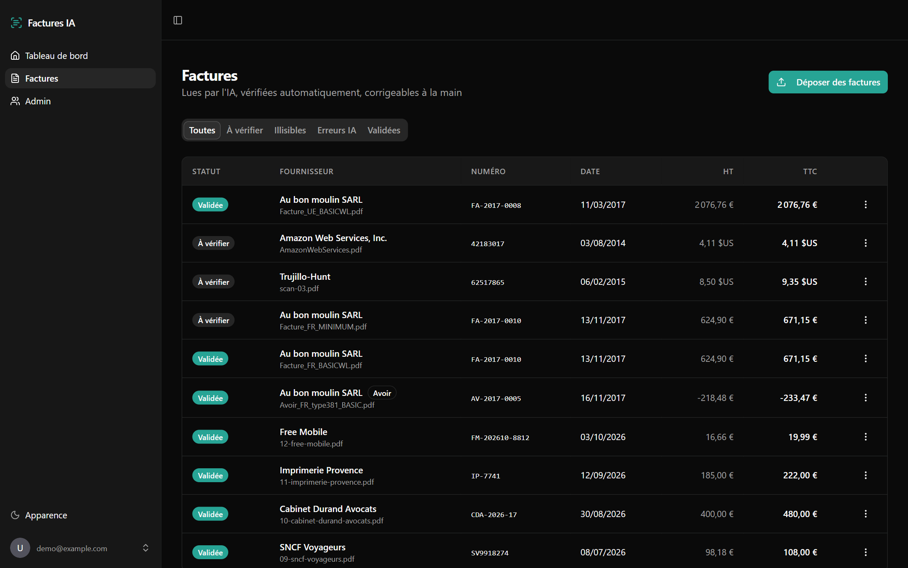
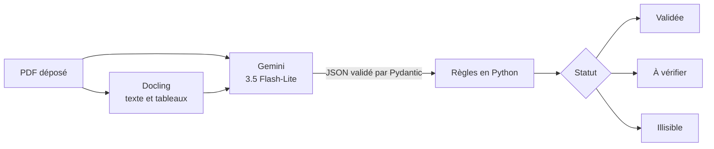
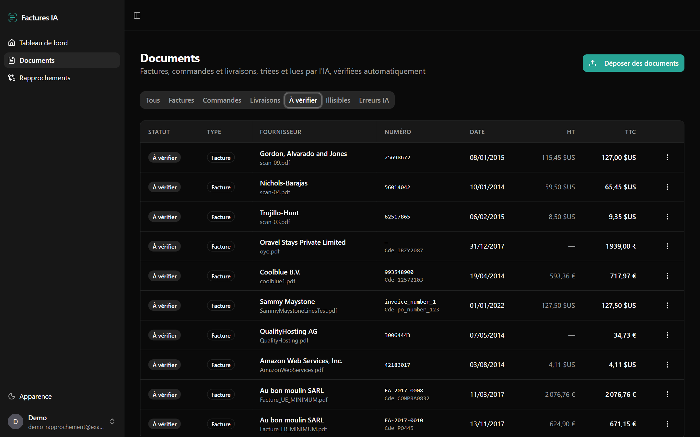
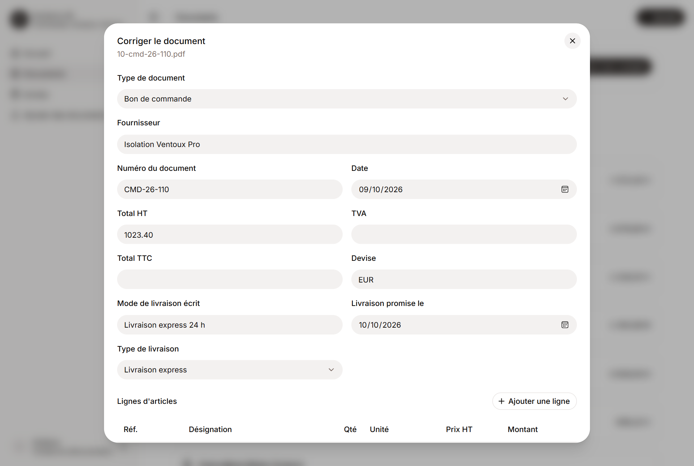

<div align="center">
  

  [](https://github.com/Jeremy84100/factures-ia/actions/workflows/test-backend.yml)
  [](https://factures-ia.vercel.app)
  [](https://www.python.org)
  [](https://fastapi.tiangolo.com)
  [](https://react.dev)
  [](LICENSE)

  [Démo](#démo) • [Fonctionnement](#fonctionnement) • [Vérifications](#vérifications) • [Résultats](#résultats-mesurés) • [Lancer en local](#lancer-en-local) • [Crédits](#crédits-et-licence)
</div>

Factures IA lit des factures PDF avec Gemini, contrôle ce qu'il a lu avec des règles écrites en Python, puis range le résultat dans PostgreSQL. Une facture qui ne passe pas les contrôles est mise de côté avec la raison, et se corrige à la main.

Le cas d'usage visé : un cabinet comptable qui reçoit 300 factures par mois et ne veut plus les saisir.



## Démo

https://factures-ia.vercel.app

Créez un compte, puis déposez quelques factures. Celles de [`backend/tests/fixtures/invoices`](backend/tests/fixtures/invoices) passent toutes ; pour voir les contrôles en action, prenez un avoir ou une facture américaine dans les jeux de données cités plus bas.

La première lecture prend jusqu'à une minute, le temps que le serveur gratuit démarre et charge Docling. Les suivantes prennent entre 5 et 20 secondes.

## Fonctionnement



1. Le fichier est contrôlé (signature `%PDF`, 10 Mo au plus) puis stocké en base. Le traitement part en arrière-plan et l'interface se met à jour toute seule.
2. [Docling](https://github.com/docling-project/docling) extrait le texte et les tableaux des 5 premières pages.
3. Gemini reçoit le PDF complet et le texte de Docling. Il voit les logos et la mise en page, le texte l'aide à lire les chiffres. Il renvoie fournisseur, numéro, date, HT, TVA, TTC, devise, type de document (facture ou avoir) et mention d'exonération de TVA.
4. Les règles de [`checks.py`](backend/app/services/checks.py) décident du statut. Elles ne font pas appel à l'IA et sont testées seules.
5. Une facture corrigée à la main repasse les contrôles. On peut aussi relancer la lecture par l'IA.

Le tableau de bord compte les factures par statut et additionne les dépenses de l'année par fournisseur, avoirs déduits.


## Vérifications

| Règle | Exemple de message |
|---|---|
| HT + TVA = TTC, à 2 centimes près | HT + TVA = 220.00 mais TTC = 440.00 |
| Fournisseur, date et TTC présents | Champ introuvable : fournisseur |
| Même fournisseur, même numéro, même montant | Doublon possible de « facture-mars.pdf » |
| Même fournisseur, même numéro, autre montant | Même numéro que « facture-mars.pdf » mais un autre montant |
| TVA à 0 sans mention d'exonération (obligatoire en France, art. 242 nonies A de l'annexe II du CGI) | TVA à 0 sans mention d'exonération |
| Aucun montant de TVA | Montant de TVA introuvable |
| Montant négatif sur une facture qui n'est pas un avoir | Montant négatif sur une facture (avoir ?) |
| Date américaine ambiguë lue au format européen | Date « 06/02/2015 » à vérifier : jour et mois peuvent être inversés |
| Date dans le futur | Date dans le futur |

Un avoir est toujours compté en négatif, même quand il est écrit avec des montants positifs comme le prévoit la norme EN 16931.

<table>
  <tr>
    <td></td>
    <td></td>
  </tr>
</table>

## Résultats mesurés

[`scripts/evaluate.py`](backend/scripts/evaluate.py) compare les réponses à la vérité sur 12 factures françaises générées par [`scripts/generate_invoices.py`](backend/scripts/generate_invoices.py) : 100 % de champs justes. Ces factures sont propres, le chiffre ne dit donc pas grand-chose seul.

Le projet a aussi été passé sur 42 factures publiques :

- 7 exemples officiels Factur-X de la FNFE (facture France, DOM, UE, avoir) et 13 cas allemands difficiles (taxi, loyer, assurance, devise étrangère, avoirs), tirés du [corpus ZUGFeRD](https://github.com/ZUGFeRD/corpus) ;
- 12 factures d'entreprises réelles (AWS, Free, Coolblue, Hetzner, Flipkart…) tirées des tests d'[invoice2data](https://github.com/invoice-x/invoice2data) ;
- 10 scans sans texte, avec leur bonne réponse, tirés du [jeu de données de sparrow](https://huggingface.co/datasets/katanaml-org/invoices-donut-data-v1).

| | Première version (texte seul) | Version actuelle |
|---|---|---|
| Fournisseur faux ou introuvable | 4 | 0 |
| Date américaine inversée | 3, sans alerte | 3, toutes signalées |
| Avoir signalé à tort ou compté en positif | 3 | 0 |
| Facture sans TVA ni mention, non signalée | 3 | 0 ou 1 (*) |
| Montant faux non signalé | 0 | 0 |
| Montants des 10 scans | 10 justes | 10 justes |

(*) La facture AWS porte la phrase « This is not a VAT invoice ». Selon les passages, Gemini la recopie comme mention d'exonération ou non : la facture est alors validée ou signalée.

Deux idées ont été essayées puis retirées, parce que les mesures ne les justifiaient pas :

- préciser le format des dates dans la consigne : Gemini inverse toujours les dates américaines, seule la règle en Python les attrape ;
- demander à Gemini une note de confiance par champ : il se donne 1,0 sur une date fausse.

## Hébergement gratuit : ce qu'il a fallu régler

Le site tourne sur une fonction Python Vercel gratuite (2 Go de mémoire, 5 minutes par requête) et une base Neon.

| Problème constaté en ligne | Mesure | Correction |
|---|---|---|
| PyTorch tire 3 Go de pilotes NVIDIA | paquet de 4 Go et plus | version CPU de PyTorch sous Linux |
| Plusieurs lectures Docling en parallèle | serveur tué (code 137) | une seule lecture Docling à la fois |
| OCR de Docling sur des PDF chargés d'images | 2,46 Go | OCR coupé, Gemini lit les scans : 1,41 Go |
| PDF de 40 pages | 2,11 Go | 5 pages au plus, une par une : 1,20 Go |
| Facture bloquée « en lecture » après un plantage | pour toujours | passe en erreur au bout de 10 minutes et se relance |

## Architecture

```
backend/app/
  api/routes/invoices.py   dépôt, liste, correction, relecture, PDF, totaux
  services/pdf_reader.py   PDF vers texte (Docling)
  services/extraction.py   PDF et texte vers champs (Gemini)
  services/checks.py       règles de contrôle, sans base ni IA
  services/processing.py   enchaîne lecture, extraction et contrôles
backend/scripts/
  create_admin.py          crée un administrateur, mot de passe saisi au clavier
  evaluate.py              score sur les 12 factures de test
  vercel-build.sh          build de l'interface, modèles Docling, migrations
frontend/src/
  routes/_layout/invoices.tsx   tableau des factures, filtres par statut
  components/Invoices/          dépôt, correction, actions
```

Docling et Gemini sont derrière deux interfaces (`PdfReader`, `InvoiceExtractor`). Les 96 tests les remplacent par de fausses versions et tournent sans clé API ni réseau. Changer de modèle demande une seule classe.

Stack : FastAPI, SQLModel, Pydantic, Alembic, PostgreSQL, Docling, Gemini (`google-genai`), React 19, Vite, TanStack Router et Query, Tailwind, shadcn/ui, Pytest, uv, bun. Tests et lint dans GitHub Actions, déploiement continu sur Vercel.

## Lancer en local

Il faut Docker Desktop, [uv](https://docs.astral.sh/uv/) et [bun](https://bun.sh).

```bash
cp .env.example .env
```

Dans `.env`, mettez votre `SECRET_KEY`, le mot de passe Postgres et votre `GEMINI_API_KEY` ([Google AI Studio](https://aistudio.google.com)).

```bash
docker compose up -d db
cd backend && uv sync && uv run alembic upgrade head && uv run python scripts/create_admin.py
cd ../frontend && bun install && bun run build
cd ../backend && uv run fastapi dev
```

L'application est sur http://localhost:8000. Sous Windows, préfixez les commandes `fastapi` par `PYTHONUTF8=1` si la console affiche une erreur d'encodage.

```bash
cd backend && uv run pytest
cd backend && uv run python scripts/evaluate.py
```

## Crédits et licence

- [Full Stack FastAPI Template](https://github.com/fastapi/full-stack-fastapi-template) (MIT, voir [`LICENSE-full-stack-fastapi-template`](LICENSE-full-stack-fastapi-template)) : base du projet, comptes, interface.
- [paperless-ngx](https://github.com/paperless-ngx/paperless-ngx) : traitement en arrière-plan, une erreur claire par étape.
- [sparrow](https://github.com/katanaml/sparrow) : interface commune pour changer de modèle d'extraction.
- [TaxHacker](https://github.com/vas3k/TaxHacker) : consigne par champ dans le schéma, règle « ne rien inventer », limite du nombre de pages lues.

Licence GPL-3.0.
